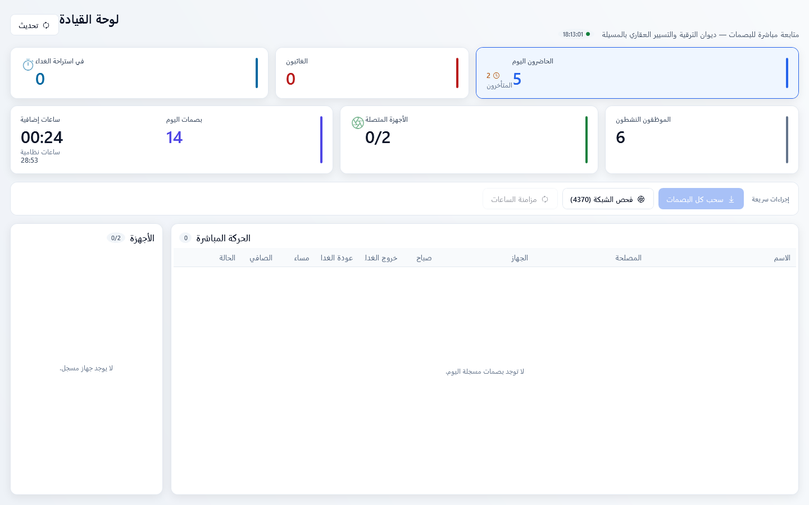
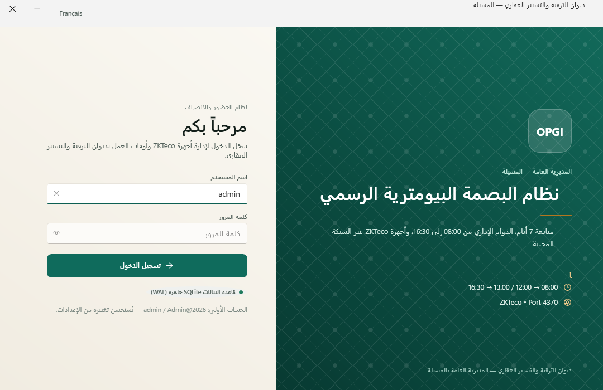
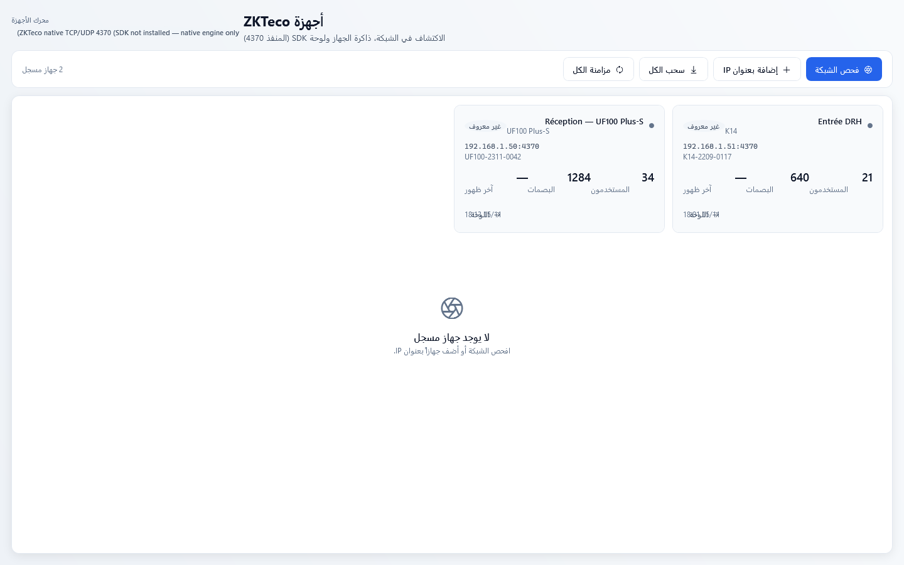
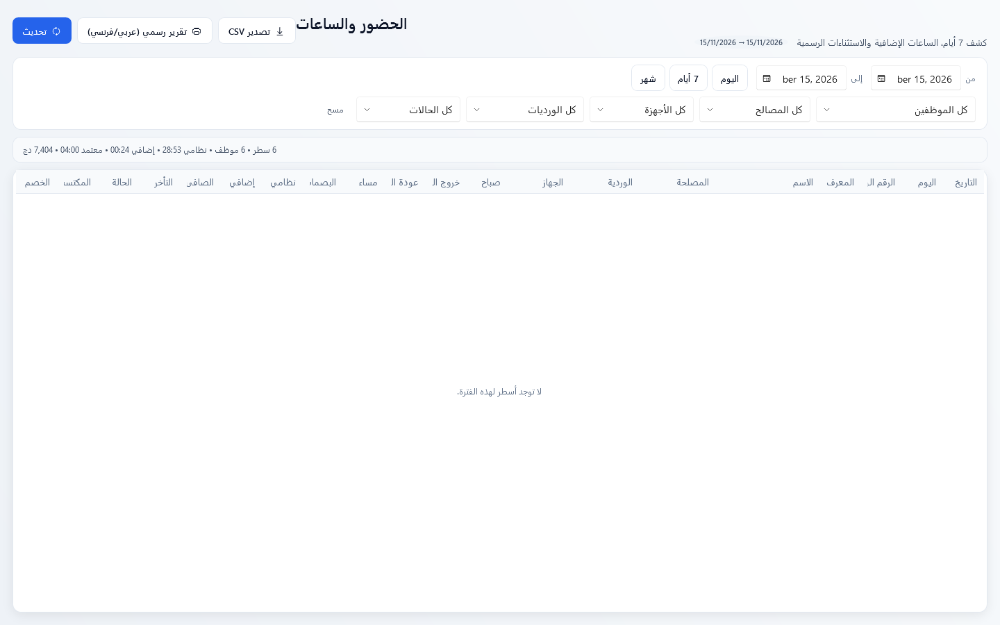
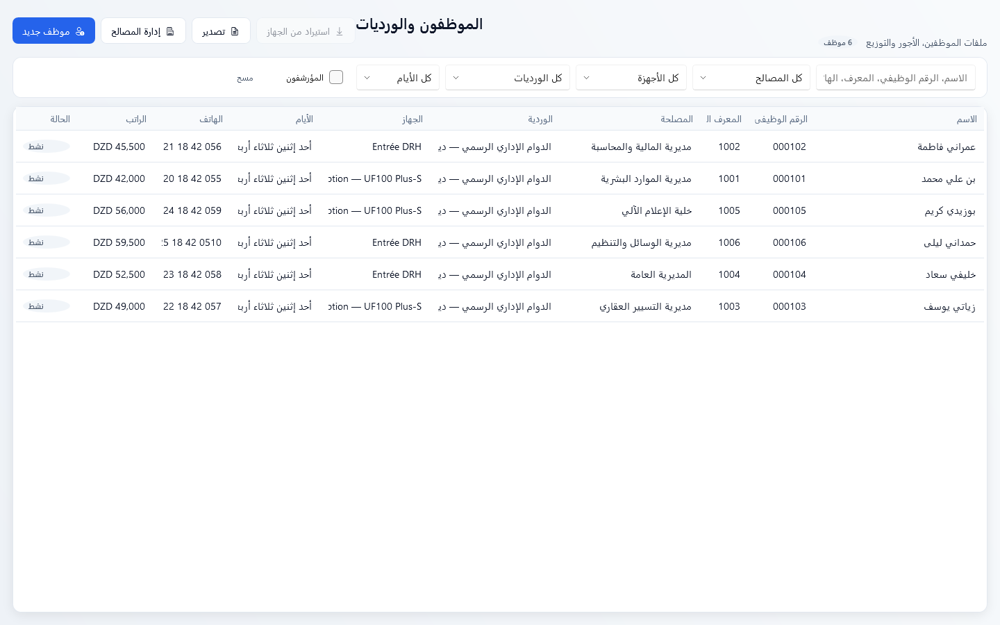
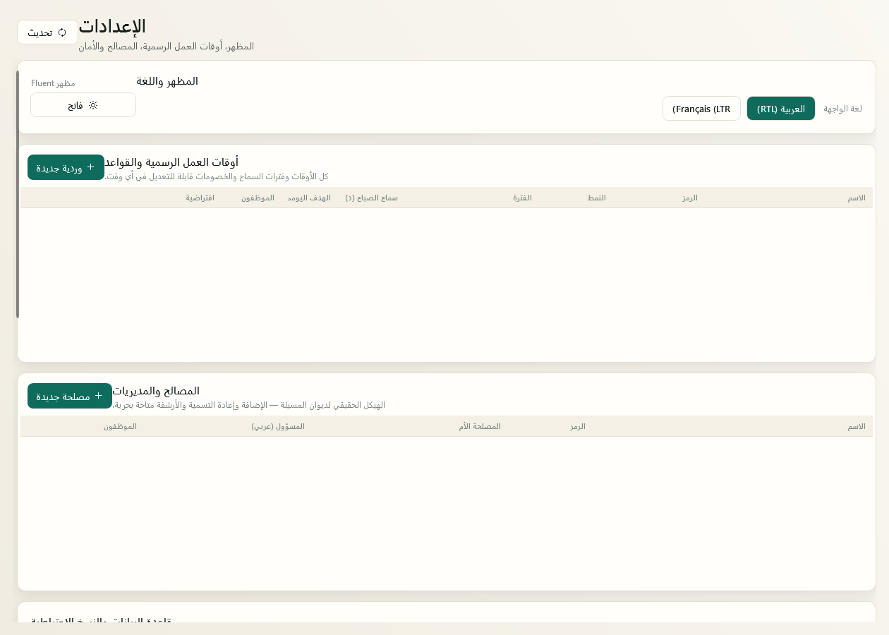
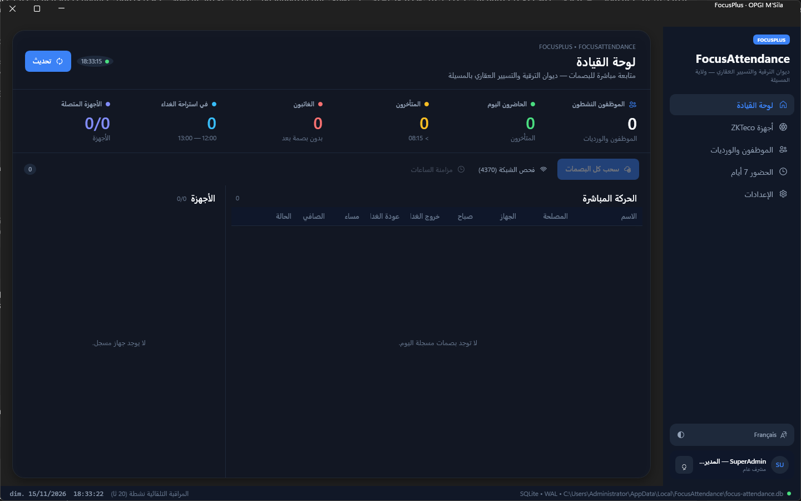
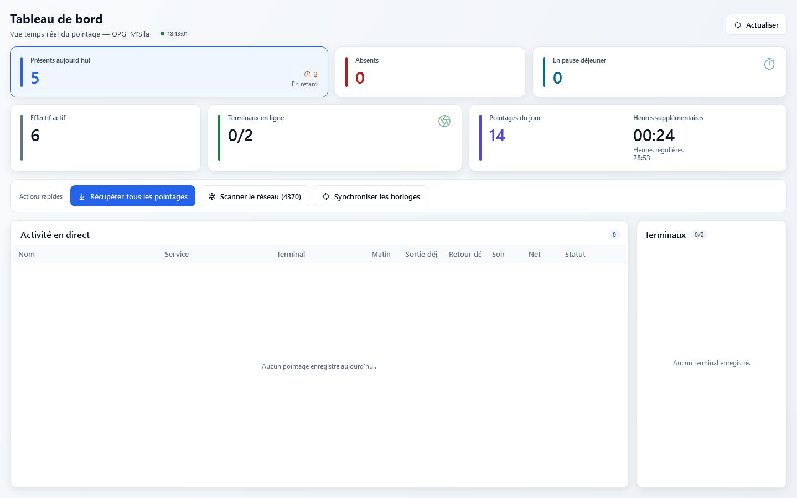

# Focus Attendance — OPGI M'Sila

نظام الحضور والانصراف البيومتري — ديوان الترقية والتسيير العقاري، ولاية المسيلة  
Système de pointage biométrique — Office de Promotion et de Gestion Immobilière, M'Sila

A local-first Windows desktop application for reading ZKTeco terminals over the LAN (port 4370),
computing the official OPGI administrative working time (08:00 → 12:00 / 13:00 → 16:30) with a
15-minute grace period, and producing an auditable 7-day attendance sheet in Arabic and French.



---

## 1. What it does

| Workspace | Capabilities |
|---|---|
| **Login gate** | SuperAdmin authentication (PBKDF2-SHA256), instant Arabic (RTL) / French (LTR) switch, SQLite health indicator |
| **Dashboard** | 6 KPI cards (present / late / absent / on lunch / active employees / online terminals / daily scans + extra hours), quick actions, live activity feed, terminal rail |
| **Terminals** | Real LAN discovery on TCP/UDP **4370**, live snapshot (serial, model, firmware, MAC, clock, users, fingerprints, faces, punches), full SDK console, device memory inspector |
| **Employees** | Directory with 7-day filters + full CRUD drawer: identity, service, shift, 7-day schedule, salary, device privileges, archive/restore |
| **Attendance** | 7-day / monthly sheet with raw-scan drawer, manual verified punches, official exceptions (mission, exit permit, leave), CSV + printable bilingual report |
| **Settings** | Language/theme, **shifts CRUD** (official times, grace, lunch deduction, anti-bounce, target), **services CRUD**, SQLite/WAL health, rolling backups, operator accounts |

Everything is fully bilingual (Arabic RTL + French LTR) and switches live without restarting.

---

## 2. Stack

- **.NET 10** (`net10.0-windows10.0.19041.0`), C# 13
- **WPF-UI 4.3.0** — Microsoft Fluent 2: Mica backdrop, flat `NavigationView`, ContentDialog, Snackbar, Fluent cards, shimmer skeletons
- **Fluent System Icons** (`SymbolRegular`) everywhere
- **SQLite** (`Microsoft.Data.Sqlite`) + **Dapper**, WAL journal, foreign keys, rolling backups, strict soft-delete
- **xUnit** — 93 automated tests

```
FocusAttendance.sln
├─ src/FocusAttendance.Domain        entities, enums, attendance rule engine (pure, testable)
├─ src/FocusAttendance.Data          SQLite schema/migrations, repositories, seeding, backups
├─ src/FocusAttendance.Hardware      ZKTeco protocol (TCP/UDP 4370), parsers, LAN scanner, optional COM SDK
├─ src/FocusAttendance.Application   services, MVVM view models, exports (no WPF dependency)
├─ src/FocusAttendance.App           WPF UI (Fluent 2), AR/FR resources, composition root
└─ tests/FocusAttendance.Tests       engine, protocol, database, services, view models
```

---

## 3. Build, run, test

```powershell
dotnet build FocusAttendance.sln -c Release
dotnet test  tests/FocusAttendance.Tests/FocusAttendance.Tests.csproj -c Release
dotnet run   --project src/FocusAttendance.App -c Release
```

Headless verification (database laws + attendance engine + LAN scan on 4370):

```powershell
.\src\FocusAttendance.App\bin\Release\net10.0-windows10.0.19041.0\FocusAttendance.exe --selftest
Get-Content "$env:LOCALAPPDATA\FocusAttendance\Logs\selftest.log"
```

**Initial SuperAdmin** — `admin` / `Admin@2026` (change it in *Paramètres → Sécurité*).
The password can be overridden at first initialisation with `FOCUS_ADMIN_PASSWORD`.

---

## 4. Data & safety rules

- Database: `%LOCALAPPDATA%\FocusAttendance\focus-attendance.db` (override via `AppHost` ctor).
- **No fake data**: a fresh database contains **0 employees, 0 devices, 0 punches**. Only the real
  OPGI organisation baseline is seeded: 1 site, 12 departments/services (DG, DRH, DFC, DGI, DPI, DPF,
  DMO, CI, local agency, technical/archive units) in AR/FR, 2 editable shifts and the SuperAdmin.
- **Zero hard delete**: every table exposes `IsArchived`, `ArchivedAtUtc`, `ArchiveReason`, `ArchivedBy`
  and a restore path. Raw punches are immutable.
- **Strict deduplication**: `UNIQUE(DeviceSerialNumber + DevicePin + PunchTimeUtc)`; re-pulling a device
  never duplicates a punch.
- **Rolling backups**: a startup backup is created automatically (`VACUUM INTO`), 30 kept; manual backup
  and restore are available in Settings (a safety backup is taken before any restore).
- **Audit trail**: logins, device IP changes, archives/restores, HR adjustments and hardware operations
  are written to `AuditLogs` / `HardwareOperationLogs`.

---

## 5. Attendance rules (engine: `FocusAttendance.Domain.Attendance`)

| Rule | Behaviour |
|---|---|
| Official shift | 08:00 – 12:00 / 13:00 – 16:30, **15 min** morning & afternoon grace, **5 min** early-leave grace, **450 min** target |
| 4-scan pattern | `(LunchOut − MorningIn) + (EveningOut − LunchIn)` — e.g. 08:00/12:00/13:00/16:30 → **07:30** |
| 2-scan pattern | span minus the configured lunch break when it crosses 12:00–13:00 → **07:30** |
| Multi-scan / free time | sequential IN/OUT pairs are summed; the `FreeTime` rule credits every completed pair |
| Missing out-scan | odd scan count → flagged `MissingOutScan`, HR can add a **verified manual punch** (audited) |
| Off-day work | all 7 days are tracked; Friday/Saturday or rest-day scans become **extra / free-time hours**, never dropped |
| Late / early leave | computed from the configurable grace periods, with a DZD deduction preview |
| Exceptions | Ordre de mission, bon de sortie, congé annuel/maladie — credited hours, auditable and archivable |
| Salary preview | hourly rate taken from `HourlyRateDzd`, else `DailyRateDzd`, else `BaseSalary / 30`; extra hours use `OvertimeMultiplier` |

Every parameter above is **editable at runtime** in *Settings → Shifts*, and changes recalculate the
sheet immediately (covered by tests).

---

## 6. ZKTeco hardware layer

Dual engine, native first:

1. **Native protocol (default, always available)** — real port-4370 binary protocol over TCP with a UDP
   fallback: packet framing & checksum, COMM-key authentication, buffered reads, 8/16/40-byte attendance
   records, 28/72/120-byte user records, memory sizes, clock codec, network options, reboot/power-off,
   clear-administrators, voice test.
2. **Official Standalone SDK (`zkemkeeper` COM)** — used automatically if the DLL is installed **and**
   instantiable; otherwise the native engine is used and the UI reports “SDK not installed”.

**IP change pipeline** (SuperAdmin):

```
verify serial at current IP → write IPAddress/NetMask/GATEIPAddress into NVRAM
→ persist new endpoint + audit → reboot → poll the NEW IP every 2 s for 60 s
→ verify serial → sync clock → pull new punches → mark online
```

A background `DeviceMonitorService` keeps every enabled terminal’s status, latency, clock drift, user
and punch counts live, reconnects after power/LAN loss, and pulls new punches when the device counter
changes. Duplicate serial numbers and duplicate endpoints are blocked at the database level.

> Hardware operations require a real terminal on the LAN. The UI never fabricates devices, users or
> punches; the `--selftest` performs a genuine discovery scan on port 4370 (0 devices is a valid result
> when no hardware is connected).

---

## 7. UI

- Fluent 2 shell: `FluentWindow` + Mica, custom `TitleBar`, flat `NavigationView`, status bar.
- **No nested TabControl** and **no cascading popup windows**: all editing happens in a single in-page
  slide-over drawer; confirmations use one in-window Fluent `ContentDialog`; notifications use snackbars.
- Brand palette: OPGI emerald `#0F6B5C` + ochre `#B4761F` on warm sand, with a subtle Andalusian lattice
  on the login panel. The WPF-UI accent is set to the same emerald (no generic blue).
- Full RTL: layout mirroring, flow-aware text alignment, LTR-isolated technical values, bilingual exports.
- Keyboard: `Ctrl+1…5` switch workspace, `Esc` closes a drawer.

| Login (AR) | Terminal console | Attendance (AR) |
|---|---|---|
|  |  |  |

| Employees (AR) | Settings (AR) | Dashboard (dark) |
|---|---|---|
|  |  |  |



---

## 8. Tests

```powershell
dotnet test
```

Coverage highlights:

- **Engine** — 4-scan exact hours, 2-scan lunch deduction, grace boundaries (08:15:59 vs 08:16), late +
  early leave, missing out-scan, single scan, off-day extra hours, free-time pairs, anti-bounce,
  manual completion, mission/leave crediting, overtime multiplier, custom shifts.
- **Protocol** — official checksum vector, TCP framing, time codec, COMM key, 8/16/40-byte attendance
  parsing, 72/28-byte user round-trips, memory sizes.
- **Database** — zero fake data, real OPGI seed, WAL, unique serial/endpoint, punch dedup, soft
  archive/restore, backups, audit.
- **Services** — employee/department/shift CRUD and validation, device import, duplicate serial blocking,
  network-update validation, dynamic recalculation after shift changes, CSV/HTML exports, dashboard KPIs.
- **View models** — directory loading, search, 7-day sheet, settings and devices loading.

---

## 9. Dev tools

- `tools/UiRender` — deterministic screenshot harness that renders every workspace (light/dark, AR/FR)
  on a throw-away database; used to catch XAML runtime errors without driving the app.
- `docs/screenshots` — reference renders.

## 10. Notes

- The COM SDK is optional; if `zkemkeeper.dll` is present but not registered, the app stays on the native
  engine (the Settings/Devices header shows the exact engine in use).
- The device clock is trusted for punch timestamps (the app can sync it). Ensure terminals are on the
  same timezone as the workstation.
